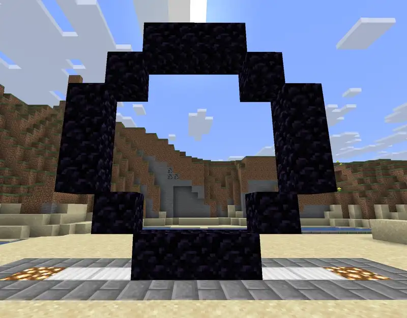
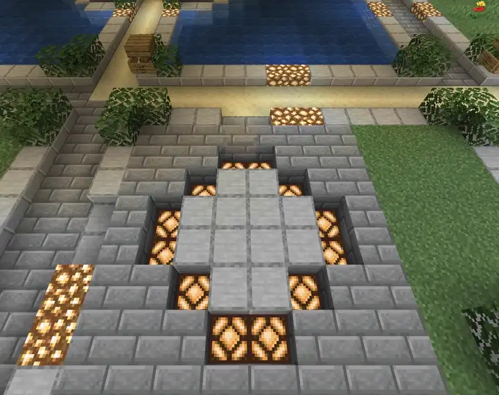
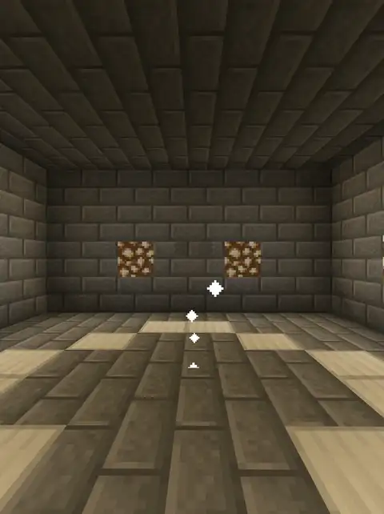
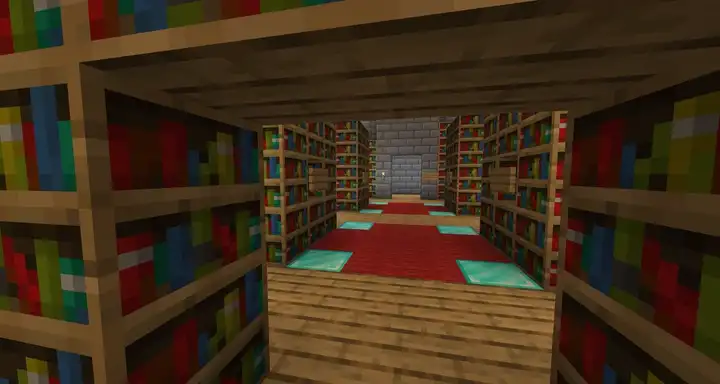
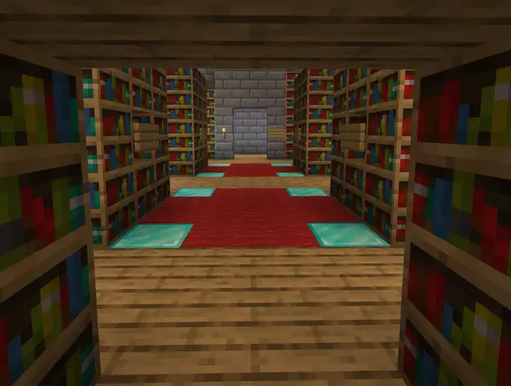

<p align="center">
  
</p>

<div align="center">

[](https://github.com/khanjal/Wormhole-X-Treme/actions/workflows/ci.yml)
[](https://github.com/khanjal/Wormhole-X-Treme/actions/workflows/ci.yml)
[](https://sonarcloud.io/component_measures?id=khanjal_Wormhole-X-Treme&metric=coverage)
[](https://sonarcloud.io/summary/overall/?id=khanjal_Wormhole-X-Treme)
[](https://sonarcloud.io/summary/overall/?id=khanjal_Wormhole-X-Treme)
[](https://sonarcloud.io/summary/overall/?id=khanjal_Wormhole-X-Treme)

[](#compatibility)
[](#building-from-source)
[](LICENSE)
[](https://bstats.org/plugin/bukkit/Wormhole%20X-Treme/34269)

</div>

| Where to get it | Version | Downloads |
|---|---|---|
| [GitHub releases](https://github.com/khanjal/Wormhole-X-Treme/releases/latest) | [](https://github.com/khanjal/Wormhole-X-Treme/releases/latest) | [](https://github.com/khanjal/Wormhole-X-Treme/releases/latest) |
| [SpigotMC](https://www.spigotmc.org/resources/wormhole-x-treme.138936/) | [](https://www.spigotmc.org/resources/wormhole-x-treme.138936/) | [](https://www.spigotmc.org/resources/wormhole-x-treme.138936/) |
| [Hangar](https://hangar.papermc.io/khanjal/Wormhole-X-Treme) | [![Hangar version](https://img.shields.io/badge/dynamic/json?url=https%3A%2F%2Fhangar.papermc.io%2Fapi%2Fv1%2Fprojects%2FWormhole-X-Treme%2Fversions%3Flimit%3D1&query=%24.result%5B0%5D.name&label=version&color=blue&logo=data%3Aimage%2Fsvg%2Bxml%3Bbase64%2CPHN2ZyB4bWxucz0iaHR0cDovL3d3dy53My5vcmcvMjAwMC9zdmciIHZpZXdCb3g9IjAgMCA3MDAgNzAwIj48ZyB0cmFuc2Zvcm09InRyYW5zbGF0ZSgwLDcwMCkgc2NhbGUoLjEsLS4xKSIgZmlsbD0iI2ZmZiI%2BPHBhdGggZD0iTTM5NTAgNjgzMyBjLTUyIC0zNiAtMTI1IC04NiAtMTYyIC0xMTEgbC02OCAtNDUgLTQ1IDQyIGMtMjQgMjIgLTQ5IDQxIC01NCA0MSAtOSAwIC0zNTkgLTI4NCAtODY5IC03MDcgbC0yMzMgLTE5MyAtNzY0IDAgLTc2NSAwIDAgLTIyOSAwIC0yMjkgLTEzOCAtMzIgYy0zMzMgLTc4IC0zNDcgLTgyIC0zNTAgLTExMSAtMiAtMjAgNjQgLTMxMSA5NCAtNDEwIDMgLTExIC0xMSAtMjIgLTQ2IC0zOSAtMjcgLTEzIC01MCAtMjggLTUwIC0zNCAwIC0xMiAxMDkgLTM2NiAzMjYgLTEwNTQgbDE2NSAtNTIzIC0zIC0xMjAgLTMgLTEyMSAtMjE1IDQ1MyBjLTExOCAyNTAgLTI2MCA1NTAgLTMxNyA2NjcgLTExNSAyMzkgLTEwMyAyMjggLTE4MyAxNTYgLTIwIC0xOSAtNDIgLTM0IC00NyAtMzQgLTkgMCAtMTUwIC0xMDQgLTE3NiAtMTMwIC0xMyAtMTIgMTk4IC0zMjMgMjgyIC00MTUgbDM2IC00MCAtMzcgMzQgLTM4IDM1IC0yMyAtMjIgYy0xMyAtMTMgLTMwIC0zMyAtMzcgLTQ2IC0xMiAtMjMgMSAtNDAgMjMyIC0zMjIgMTM0IC0xNjUgMzA4IC0zNzggMzg2IC00NzUgbDE0MiAtMTc2IDIgLTg0OSAzIC04NDkgMjc3IC0zIDI3NiAtMiAxMSAtNDMgYzg0IC0zMzkgMTAyIC0zOTcgMTIzIC0zOTcgMTAgMCAxMDggMjMgMjE4IDUwIDExMCAyOCAyMDEgNTAgMjAzIDUwIDIgMCAxNSAtMjIgMjggLTUwIDEzIC0yNyAyNyAtNTAgMzEgLTUwIDYgMCA3NTQgMjMyIDEzMjMgNDA5IDEyMiAzOSAxMzcgNDEgMjUyIDQxIDY4IDAgMTIzIC0zIDEyMyAtNyAtMSAtNSAtNzYgLTQ0IC0xNjggLTg4IC03OTIgLTM3OCAtMTAzNSAtNDk0IC0xMDM5IC00OTkgLTMgLTMgMTUgLTI5IDQxIC01OSAyNSAtMzAgNDYgLTU5IDQ2IC02NCAwIC01IDMxIC01MSA2OSAtMTAxIGw2OCAtOTIgMTc5IDEyNiBjOTggNzAgMTkyIDEzOCAyMDggMTUzIDI1IDIzIDI3IDIzIDE1IDQgLTEzIC0yMSAtMTEgLTI2IDI2IC02MyBsNDEgLTQwIDI0OSAyMDEgYzEzOCAxMTEgMzQwIDI3NSA0NDkgMzYzIGwxOTkgMTYxIDgzMSAwIDgzMSAwIDMgMjkyIDIgMjkyIDUzIDE2IGMyOCA5IDEyMiAzMSAyMDcgNTAgMjQzIDU1IDI2MCA2MSAyNjAgOTEgMCAyMSAtNzUgMzM5IC05NSA0MDQgLTMgMTAgMTMgMjQgNTAgNDQgMzAgMTYgNTUgMzIgNTUgMzYgMCAxMSAtMjc3IDkwNyAtNDE1IDEzNDUgLTExNCAzNTggLTExNiAzNjcgLTExMyA0NDcgbDMgODMgMjA0IC00MjUgYzExMiAtMjM0IDI1NiAtNTM1IDMxOSAtNjcwIDExNyAtMjQ5IDEzOCAtMjkwIDE1MiAtMjkwIDQgMCA0NyAzMCA5NiA2NiA0OSAzNyAxMTcgODcgMTUyIDExMSA1NiA0MSA2MSA0NyA0OSA2MiAtOCA5IC00MCA1MyAtNzEgOTkgLTMxIDQ1IC03OCAxMTIgLTEwNiAxNDggbC01MCA2NiA0NSA1MSBjMjUgMjggNDUgNTUgNDUgNTkgMCA0IC0xODkgMjM3IC00MjAgNTE5IGwtNDIwIDUxMiAwIDc1MyAwIDc1NCAtOTggMCBjLTU1IDAgLTE2NiAzIC0yNDkgNyBsLTE1MCA2IC00MiAxNzEgYy0yMyA5NCAtNTYgMjIyIC03MyAyODQgLTI4IDEwNCAtMzIgMTEyIC01NSAxMTIgLTIwIDAgLTMzNCAtNzQgLTQwNCAtOTUgLTExIC00IC0yMiAxMCAtMzkgNDYgLTIxIDQ1IC0yNyA1MCAtNTAgNDUgLTU0IC0xMSAtMTcyOCAtNTI2IC0xNzcwIC01NDUgLTYwIC0yNiAtMTA2IC0zMyAtMTU4IC0yNCAtNDIgOCAtMzcgMTEgNzAzIDM2MiA0MTAgMTk1IDc0OCAzNTcgNzUwIDM2MSAzIDQgLTE4IDM2IC00NiA3MSAtMjggMzUgLTc4IDEwMyAtMTEwIDE1MiAtMzMgNDggLTYzIDg3IC02NyA4NyAtNCAwIC01MCAtMzAgLTEwMiAtNjd6IG0tMjMwIC0xNjcgYzAgLTIgLTggLTEwIC0xNyAtMTcgLTE2IC0xMyAtMTcgLTEyIC00IDQgMTMgMTYgMjEgMjEgMjEgMTN6IG0tNzAgLTUwIGMwIC0zIC0xNSAtMTQgLTMyIC0yNiBsLTMzIC0yMiAzMCAyNiBjMzEgMjcgMzUgMjkgMzUgMjJ6IG0tMTAwIC03MCBjMCAtMyAtMTUgLTE0IC0zMiAtMjYgbC0zMyAtMjIgMzAgMjYgYzMxIDI3IDM1IDI5IDM1IDIyeiBtLTEzMCAtOTAgYzAgLTIgLTggLTEwIC0xNyAtMTcgLTE2IC0xMyAtMTcgLTEyIC00IDQgMTMgMTYgMjEgMjEgMjEgMTN6IG0tNzAgLTUwIGMwIC0zIC0xNSAtMTQgLTMyIC0yNiBsLTMzIC0yMiAzMCAyNiBjMzEgMjcgMzUgMjkgMzUgMjJ6IG0tMTAwIC03MCBjMCAtMyAtMTUgLTE0IC0zMiAtMjYgbC0zMyAtMjIgMzAgMjYgYzMxIDI3IDM1IDI5IDM1IDIyeiBtLTcwIC01MCBjMCAtMyAtMTUgLTE0IC0zMiAtMjYgbC0zMyAtMjIgMzAgMjYgYzMxIDI3IDM1IDI5IDM1IDIyeiBtLTEwMCAtNzAgYzAgLTIgLTggLTEwIC0xNyAtMTcgLTE2IC0xMyAtMTcgLTEyIC00IDQgMTMgMTYgMjEgMjEgMjEgMTN6IG0tNzAgLTUwIGMwIC0yIC04IC0xMCAtMTcgLTE3IC0xNiAtMTMgLTE3IC0xMiAtNCA0IDEzIDE2IDIxIDIxIDIxIDEzeiBtLTcwIC01MCBjMCAtMiAtOCAtMTAgLTE3IC0xNyAtMTYgLTEzIC0xNyAtMTIgLTQgNCAxMyAxNiAyMSAyMSAyMSAxM3ogbS03MCAtNTAgYzAgLTIgLTggLTEwIC0xNyAtMTcgLTE2IC0xMyAtMTcgLTEyIC00IDQgMTMgMTYgMjEgMjEgMjEgMTN6IG0tNDAgLTMwIGMwIC0zIC0xNSAtMTQgLTMyIC0yNiBsLTMzIC0yMiAzMCAyNiBjMzEgMjcgMzUgMjkgMzUgMjJ6IG0tNzAgLTUwIGMwIC0zIC0xNSAtMTQgLTMyIC0yNiBsLTMzIC0yMiAzMCAyNiBjMzEgMjcgMzUgMjkgMzUgMjJ6IG0tNzAgLTUwIGMwIC0yIC04IC0xMCAtMTcgLTE3IC0xNiAtMTMgLTE3IC0xMiAtNCA0IDEzIDE2IDIxIDIxIDIxIDEzeiBtLTQ1IC0zNiBjLTMgLTUgLTE2IC0xNSAtMjggLTIxIC0xOSAtOSAtMTkgLTggMyAxMCAyOCAyMyAzNCAyNiAyNSAxMXogbTEyNjAgLTgzMCBjMzQ3IC0xNDQgNjM2IC0yNjUgNjQzIC0yNjkgOCAtNSAtMTggLTI2IC03NSAtNTkgLTU5OSAtMzU2IC0xMDExIC0xMDE0IC0xMTM0IC0xODEyIC0zMyAtMjA5IC0zMyAtNTkwIDAgLTgwMCAyOCAtMTg1IDY5IC0zNTMgMTIxIC01MDUgMjMgLTY2IDQ0IC0xMjggNDcgLTEzNyA0IC0xNSAtMTYgLTkgLTEwMyAyNyAtNjAgMjUgLTM2MyAxNTAgLTY3NCAyNzggbC01NjUgMjM0IC0zOCAxMDQgYy0yMiA1NyAtNTYgMTcyIC03NyAyNTUgLTE1MSA1ODkgLTEwOCAxMjE3IDEyMCAxNzczIDIwMiA0OTIgNTMxIDg4OCA5NDggMTE0MiA5MCA1NSA5NSA1NyAxMjUgNDQgMTggLTcgMzE2IC0xMzEgNjYyIC0yNzV6IG0yMDU1IC04NzAgYzEyIC0xNiAxOSAtMzAgMTYgLTMwIC0yIDAgLTE0IDE0IC0yNiAzMCAtMTIgMTcgLTE5IDMwIC0xNiAzMCAyIDAgMTQgLTEzIDI2IC0zMHogbTUwIC03MCBjMTIgLTE2IDE5IC0zMCAxNiAtMzAgLTIgMCAtMTQgMTQgLTI2IDMwIC0xMiAxNyAtMTkgMzAgLTE2IDMwIDIgMCAxNCAtMTMgMjYgLTMweiBtNDEgLTU3IGMxMyAtMTYgMTIgLTE3IC0zIC00IC0xMCA3IC0xOCAxNSAtMTggMTcgMCA4IDggMyAyMSAtMTN6IG0tMTc0OSAtMjA2IGwzOTEgLTE2MiAtODAgLTYgYy0xMzYgLTEwIC0yNTIgLTc4IC00MDMgLTIzNSAtMjUyIC0yNjIgLTQ0OCAtNzAxIC01MTUgLTExNTQgLTIxIC0xNDEgLTMwIC00NDMgLTE3IC01NjUgNSAtNDkgOCAtOTIgNiAtOTQgLTIgLTIgLTMzIDggLTY5IDI0IGwtNjUgMjcgLTIxIDcxIGMtMzIgMTA3IC02NiAyNjggLTg1IDQwMiAtMjUgMTY1IC0yNSA1MzIgLTEgNzA1IDQ2IDMyOCAxNTcgNjczIDI5OCA5MjQgODMgMTQ3IDE0NCAyMzYgMTU3IDIzMSA4IC0zIDE4OSAtNzggNDA0IC0xNjh6IG0xNzk5IDEzNiBjMTMgLTE2IDEyIC0xNyAtMyAtNCAtMTAgNyAtMTggMTUgLTE4IDE3IDAgOCA4IDMgMjEgLTEzeiBtNTAgLTcwIGMxMyAtMTYgMTIgLTE3IC0zIC00IC0xMCA3IC0xOCAxNSAtMTggMTcgMCA4IDggMyAyMSAtMTN6IG01MCAtNzAgYzEzIC0xNiAxMiAtMTcgLTMgLTQgLTEwIDcgLTE4IDE1IC0xOCAxNyAwIDggOCAzIDIxIC0xM3ogbTg5IC0xMjMgYzEyIC0xNiAxOSAtMzAgMTYgLTMwIC0yIDAgLTE0IDE0IC0yNiAzMCAtMTIgMTcgLTE5IDMwIC0xNiAzMCAyIDAgMTQgLTEzIDI2IC0zMHogbTYxIC04NyBjMTMgLTE2IDEyIC0xNyAtMyAtNCAtMTAgNyAtMTggMTUgLTE4IDE3IDAgOCA4IDMgMjEgLTEzeiBtLTE1NzkgLTY4IGMxMjggLTg1IDE5NyAtMzI3IDE5OCAtNjk1IDAgLTIyNiAtMzEgLTU4MCAtNTIgLTU4MCAtMTMgMCAtOTgxIDQwMCAtOTkxIDQxMCAtMTEgMTAgNjAgMTkyIDEyNCAzMTcgMTUxIDI5NCAzNDQgNDk4IDUzNCA1NjYgNjMgMjIgMTM2IDE1IDE4NyAtMTh6IG0tNDM4MiAtNSBjMTIgLTE2IDE5IC0zMCAxNiAtMzAgLTIgMCAtMTQgMTQgLTI2IDMwIC0xMiAxNyAtMTkgMzAgLTE2IDMwIDIgMCAxNCAtMTMgMjYgLTMweiBtNjAxMSAzIGMxMyAtMTYgMTIgLTE3IC0zIC00IC0xMCA3IC0xOCAxNSAtMTggMTcgMCA4IDggMyAyMSAtMTN6IG03MCAtMTAwIGMxMyAtMTYgMTIgLTE3IC0zIC00IC0xMCA3IC0xOCAxNSAtMTggMTcgMCA4IDggMyAyMSAtMTN6IG0tNjAwMCAtMjAgYzEzIC0xNiAxMiAtMTcgLTMgLTQgLTEwIDcgLTE4IDE1IC0xOCAxNyAwIDggOCAzIDIxIC0xM3ogbTYwNTAgLTUwIGMxMyAtMTYgMTIgLTE3IC0zIC00IC0xMCA3IC0xOCAxNSAtMTggMTcgMCA4IDggMyAyMSAtMTN6IG0tNTk3MSAtNjMgYzEyIC0xNiAxOSAtMzAgMTYgLTMwIC0yIDAgLTE0IDE0IC0yNiAzMCAtMTIgMTcgLTE5IDMwIC0xNiAzMCAyIDAgMTQgLTEzIDI2IC0zMHogbTYwNDEgLTM3IGMxMyAtMTYgMTIgLTE3IC0zIC00IC0xMCA3IC0xOCAxNSAtMTggMTcgMCA4IDggMyAyMSAtMTN6IG0tNTk3MSAtNjMgYzEyIC0xNiAxOSAtMzAgMTYgLTMwIC0yIDAgLTE0IDE0IC0yNiAzMCAtMTIgMTcgLTE5IDMwIC0xNiAzMCAyIDAgMTQgLTEzIDI2IC0zMHogbTYwMjEgLTcgYzEzIC0xNiAxMiAtMTcgLTMgLTQgLTEwIDcgLTE4IDE1IC0xOCAxNyAwIDggOCAzIDIxIC0xM3ogbS01OTMxIC0xMjMgYzEyIC0xNiAxOSAtMzAgMTYgLTMwIC0yIDAgLTE0IDE0IC0yNiAzMCAtMTIgMTcgLTE5IDMwIC0xNiAzMCAyIDAgMTQgLTEzIDI2IC0zMHogbTYxIC04NyBjMTMgLTE2IDEyIC0xNyAtMyAtNCAtMTAgNyAtMTggMTUgLTE4IDE3IDAgOCA4IDMgMjEgLTEzeiBtNTkgLTgzIGMxMiAtMTYgMTkgLTMwIDE2IC0zMCAtMiAwIC0xNCAxNCAtMjYgMzAgLTEyIDE3IC0xOSAzMCAtMTYgMzAgMiAwIDE0IC0xMyAyNiAtMzB6IG03MCAtMTAwIGMxMiAtMTYgMTkgLTMwIDE2IC0zMCAtMiAwIC0xNCAxNCAtMjYgMzAgLTEyIDE3IC0xOSAzMCAtMTYgMzAgMiAwIDE0IC0xMyAyNiAtMzB6IG03MCAtMTAxIGMxNSAtMjggNSAtMjMgLTE1IDcgLTkgMTUgLTEyIDIzIC02IDIwIDYgLTQgMTYgLTE2IDIxIC0yN3ogbTMxODAgLTE4MTMgYzAgLTIgLTcgLTcgLTE2IC0xMCAtOCAtMyAtMTIgLTIgLTkgNCA2IDEwIDI1IDE0IDI1IDZ6IG0tNzAgLTQwIGMwIC0yIC04IC0xMCAtMTcgLTE3IC0xNiAtMTMgLTE3IC0xMiAtNCA0IDEzIDE2IDIxIDIxIDIxIDEzeiBtLTcwIC01MCBjMCAtMyAtMTUgLTE0IC0zMiAtMjYgbC0zMyAtMjIgMzAgMjYgYzMxIDI3IDM1IDI5IDM1IDIyeiBtLTEwMCAtNzAgYzAgLTIgLTggLTEwIC0xNyAtMTcgLTE2IC0xMyAtMTcgLTEyIC00IDQgMTMgMTYgMjEgMjEgMjEgMTN6IG0tNzAgLTUwIGMwIC0zIC0xNSAtMTQgLTMyIC0yNiBsLTMzIC0yMiAzMCAyNiBjMzEgMjcgMzUgMjkgMzUgMjJ6IG0tMTAwIC03MCBjMCAtMyAtMTUgLTE0IC0zMiAtMjYgbC0zMyAtMjIgMzAgMjYgYzMxIDI3IDM1IDI5IDM1IDIyeiBtLTEwMCAtNzAgYzAgLTMgLTE1IC0xNCAtMzIgLTI2IGwtMzMgLTIyIDMwIDI2IGMzMSAyNyAzNSAyOSAzNSAyMnogbS0xMzAgLTkwIGMwIC0zIC0xNSAtMTQgLTMyIC0yNiBsLTMzIC0yMiAzMCAyNiBjMzEgMjcgMzUgMjkgMzUgMjJ6IG0tMTAwIC03MCBjMCAtMyAtMTUgLTE0IC0zMiAtMjYgbC0zMyAtMjIgMzAgMjYgYzMxIDI3IDM1IDI5IDM1IDIyeiBtLTcwIC00OSBjMCAtMiAtMTAgLTEyIC0yMiAtMjMgbC0yMyAtMTkgMTkgMjMgYzE4IDIxIDI2IDI3IDI2IDE5eiIvPjwvZz48L3N2Zz4%3D)](https://hangar.papermc.io/khanjal/Wormhole-X-Treme) | [![Hangar downloads](https://img.shields.io/hangar/dt/Wormhole-X-Treme?label=downloads&color=8957e5&logo=data%3Aimage%2Fsvg%2Bxml%3Bbase64%2CPHN2ZyB4bWxucz0iaHR0cDovL3d3dy53My5vcmcvMjAwMC9zdmciIHZpZXdCb3g9IjAgMCA3MDAgNzAwIj48ZyB0cmFuc2Zvcm09InRyYW5zbGF0ZSgwLDcwMCkgc2NhbGUoLjEsLS4xKSIgZmlsbD0iI2ZmZiI%2BPHBhdGggZD0iTTM5NTAgNjgzMyBjLTUyIC0zNiAtMTI1IC04NiAtMTYyIC0xMTEgbC02OCAtNDUgLTQ1IDQyIGMtMjQgMjIgLTQ5IDQxIC01NCA0MSAtOSAwIC0zNTkgLTI4NCAtODY5IC03MDcgbC0yMzMgLTE5MyAtNzY0IDAgLTc2NSAwIDAgLTIyOSAwIC0yMjkgLTEzOCAtMzIgYy0zMzMgLTc4IC0zNDcgLTgyIC0zNTAgLTExMSAtMiAtMjAgNjQgLTMxMSA5NCAtNDEwIDMgLTExIC0xMSAtMjIgLTQ2IC0zOSAtMjcgLTEzIC01MCAtMjggLTUwIC0zNCAwIC0xMiAxMDkgLTM2NiAzMjYgLTEwNTQgbDE2NSAtNTIzIC0zIC0xMjAgLTMgLTEyMSAtMjE1IDQ1MyBjLTExOCAyNTAgLTI2MCA1NTAgLTMxNyA2NjcgLTExNSAyMzkgLTEwMyAyMjggLTE4MyAxNTYgLTIwIC0xOSAtNDIgLTM0IC00NyAtMzQgLTkgMCAtMTUwIC0xMDQgLTE3NiAtMTMwIC0xMyAtMTIgMTk4IC0zMjMgMjgyIC00MTUgbDM2IC00MCAtMzcgMzQgLTM4IDM1IC0yMyAtMjIgYy0xMyAtMTMgLTMwIC0zMyAtMzcgLTQ2IC0xMiAtMjMgMSAtNDAgMjMyIC0zMjIgMTM0IC0xNjUgMzA4IC0zNzggMzg2IC00NzUgbDE0MiAtMTc2IDIgLTg0OSAzIC04NDkgMjc3IC0zIDI3NiAtMiAxMSAtNDMgYzg0IC0zMzkgMTAyIC0zOTcgMTIzIC0zOTcgMTAgMCAxMDggMjMgMjE4IDUwIDExMCAyOCAyMDEgNTAgMjAzIDUwIDIgMCAxNSAtMjIgMjggLTUwIDEzIC0yNyAyNyAtNTAgMzEgLTUwIDYgMCA3NTQgMjMyIDEzMjMgNDA5IDEyMiAzOSAxMzcgNDEgMjUyIDQxIDY4IDAgMTIzIC0zIDEyMyAtNyAtMSAtNSAtNzYgLTQ0IC0xNjggLTg4IC03OTIgLTM3OCAtMTAzNSAtNDk0IC0xMDM5IC00OTkgLTMgLTMgMTUgLTI5IDQxIC01OSAyNSAtMzAgNDYgLTU5IDQ2IC02NCAwIC01IDMxIC01MSA2OSAtMTAxIGw2OCAtOTIgMTc5IDEyNiBjOTggNzAgMTkyIDEzOCAyMDggMTUzIDI1IDIzIDI3IDIzIDE1IDQgLTEzIC0yMSAtMTEgLTI2IDI2IC02MyBsNDEgLTQwIDI0OSAyMDEgYzEzOCAxMTEgMzQwIDI3NSA0NDkgMzYzIGwxOTkgMTYxIDgzMSAwIDgzMSAwIDMgMjkyIDIgMjkyIDUzIDE2IGMyOCA5IDEyMiAzMSAyMDcgNTAgMjQzIDU1IDI2MCA2MSAyNjAgOTEgMCAyMSAtNzUgMzM5IC05NSA0MDQgLTMgMTAgMTMgMjQgNTAgNDQgMzAgMTYgNTUgMzIgNTUgMzYgMCAxMSAtMjc3IDkwNyAtNDE1IDEzNDUgLTExNCAzNTggLTExNiAzNjcgLTExMyA0NDcgbDMgODMgMjA0IC00MjUgYzExMiAtMjM0IDI1NiAtNTM1IDMxOSAtNjcwIDExNyAtMjQ5IDEzOCAtMjkwIDE1MiAtMjkwIDQgMCA0NyAzMCA5NiA2NiA0OSAzNyAxMTcgODcgMTUyIDExMSA1NiA0MSA2MSA0NyA0OSA2MiAtOCA5IC00MCA1MyAtNzEgOTkgLTMxIDQ1IC03OCAxMTIgLTEwNiAxNDggbC01MCA2NiA0NSA1MSBjMjUgMjggNDUgNTUgNDUgNTkgMCA0IC0xODkgMjM3IC00MjAgNTE5IGwtNDIwIDUxMiAwIDc1MyAwIDc1NCAtOTggMCBjLTU1IDAgLTE2NiAzIC0yNDkgNyBsLTE1MCA2IC00MiAxNzEgYy0yMyA5NCAtNTYgMjIyIC03MyAyODQgLTI4IDEwNCAtMzIgMTEyIC01NSAxMTIgLTIwIDAgLTMzNCAtNzQgLTQwNCAtOTUgLTExIC00IC0yMiAxMCAtMzkgNDYgLTIxIDQ1IC0yNyA1MCAtNTAgNDUgLTU0IC0xMSAtMTcyOCAtNTI2IC0xNzcwIC01NDUgLTYwIC0yNiAtMTA2IC0zMyAtMTU4IC0yNCAtNDIgOCAtMzcgMTEgNzAzIDM2MiA0MTAgMTk1IDc0OCAzNTcgNzUwIDM2MSAzIDQgLTE4IDM2IC00NiA3MSAtMjggMzUgLTc4IDEwMyAtMTEwIDE1MiAtMzMgNDggLTYzIDg3IC02NyA4NyAtNCAwIC01MCAtMzAgLTEwMiAtNjd6IG0tMjMwIC0xNjcgYzAgLTIgLTggLTEwIC0xNyAtMTcgLTE2IC0xMyAtMTcgLTEyIC00IDQgMTMgMTYgMjEgMjEgMjEgMTN6IG0tNzAgLTUwIGMwIC0zIC0xNSAtMTQgLTMyIC0yNiBsLTMzIC0yMiAzMCAyNiBjMzEgMjcgMzUgMjkgMzUgMjJ6IG0tMTAwIC03MCBjMCAtMyAtMTUgLTE0IC0zMiAtMjYgbC0zMyAtMjIgMzAgMjYgYzMxIDI3IDM1IDI5IDM1IDIyeiBtLTEzMCAtOTAgYzAgLTIgLTggLTEwIC0xNyAtMTcgLTE2IC0xMyAtMTcgLTEyIC00IDQgMTMgMTYgMjEgMjEgMjEgMTN6IG0tNzAgLTUwIGMwIC0zIC0xNSAtMTQgLTMyIC0yNiBsLTMzIC0yMiAzMCAyNiBjMzEgMjcgMzUgMjkgMzUgMjJ6IG0tMTAwIC03MCBjMCAtMyAtMTUgLTE0IC0zMiAtMjYgbC0zMyAtMjIgMzAgMjYgYzMxIDI3IDM1IDI5IDM1IDIyeiBtLTcwIC01MCBjMCAtMyAtMTUgLTE0IC0zMiAtMjYgbC0zMyAtMjIgMzAgMjYgYzMxIDI3IDM1IDI5IDM1IDIyeiBtLTEwMCAtNzAgYzAgLTIgLTggLTEwIC0xNyAtMTcgLTE2IC0xMyAtMTcgLTEyIC00IDQgMTMgMTYgMjEgMjEgMjEgMTN6IG0tNzAgLTUwIGMwIC0yIC04IC0xMCAtMTcgLTE3IC0xNiAtMTMgLTE3IC0xMiAtNCA0IDEzIDE2IDIxIDIxIDIxIDEzeiBtLTcwIC01MCBjMCAtMiAtOCAtMTAgLTE3IC0xNyAtMTYgLTEzIC0xNyAtMTIgLTQgNCAxMyAxNiAyMSAyMSAyMSAxM3ogbS03MCAtNTAgYzAgLTIgLTggLTEwIC0xNyAtMTcgLTE2IC0xMyAtMTcgLTEyIC00IDQgMTMgMTYgMjEgMjEgMjEgMTN6IG0tNDAgLTMwIGMwIC0zIC0xNSAtMTQgLTMyIC0yNiBsLTMzIC0yMiAzMCAyNiBjMzEgMjcgMzUgMjkgMzUgMjJ6IG0tNzAgLTUwIGMwIC0zIC0xNSAtMTQgLTMyIC0yNiBsLTMzIC0yMiAzMCAyNiBjMzEgMjcgMzUgMjkgMzUgMjJ6IG0tNzAgLTUwIGMwIC0yIC04IC0xMCAtMTcgLTE3IC0xNiAtMTMgLTE3IC0xMiAtNCA0IDEzIDE2IDIxIDIxIDIxIDEzeiBtLTQ1IC0zNiBjLTMgLTUgLTE2IC0xNSAtMjggLTIxIC0xOSAtOSAtMTkgLTggMyAxMCAyOCAyMyAzNCAyNiAyNSAxMXogbTEyNjAgLTgzMCBjMzQ3IC0xNDQgNjM2IC0yNjUgNjQzIC0yNjkgOCAtNSAtMTggLTI2IC03NSAtNTkgLTU5OSAtMzU2IC0xMDExIC0xMDE0IC0xMTM0IC0xODEyIC0zMyAtMjA5IC0zMyAtNTkwIDAgLTgwMCAyOCAtMTg1IDY5IC0zNTMgMTIxIC01MDUgMjMgLTY2IDQ0IC0xMjggNDcgLTEzNyA0IC0xNSAtMTYgLTkgLTEwMyAyNyAtNjAgMjUgLTM2MyAxNTAgLTY3NCAyNzggbC01NjUgMjM0IC0zOCAxMDQgYy0yMiA1NyAtNTYgMTcyIC03NyAyNTUgLTE1MSA1ODkgLTEwOCAxMjE3IDEyMCAxNzczIDIwMiA0OTIgNTMxIDg4OCA5NDggMTE0MiA5MCA1NSA5NSA1NyAxMjUgNDQgMTggLTcgMzE2IC0xMzEgNjYyIC0yNzV6IG0yMDU1IC04NzAgYzEyIC0xNiAxOSAtMzAgMTYgLTMwIC0yIDAgLTE0IDE0IC0yNiAzMCAtMTIgMTcgLTE5IDMwIC0xNiAzMCAyIDAgMTQgLTEzIDI2IC0zMHogbTUwIC03MCBjMTIgLTE2IDE5IC0zMCAxNiAtMzAgLTIgMCAtMTQgMTQgLTI2IDMwIC0xMiAxNyAtMTkgMzAgLTE2IDMwIDIgMCAxNCAtMTMgMjYgLTMweiBtNDEgLTU3IGMxMyAtMTYgMTIgLTE3IC0zIC00IC0xMCA3IC0xOCAxNSAtMTggMTcgMCA4IDggMyAyMSAtMTN6IG0tMTc0OSAtMjA2IGwzOTEgLTE2MiAtODAgLTYgYy0xMzYgLTEwIC0yNTIgLTc4IC00MDMgLTIzNSAtMjUyIC0yNjIgLTQ0OCAtNzAxIC01MTUgLTExNTQgLTIxIC0xNDEgLTMwIC00NDMgLTE3IC01NjUgNSAtNDkgOCAtOTIgNiAtOTQgLTIgLTIgLTMzIDggLTY5IDI0IGwtNjUgMjcgLTIxIDcxIGMtMzIgMTA3IC02NiAyNjggLTg1IDQwMiAtMjUgMTY1IC0yNSA1MzIgLTEgNzA1IDQ2IDMyOCAxNTcgNjczIDI5OCA5MjQgODMgMTQ3IDE0NCAyMzYgMTU3IDIzMSA4IC0zIDE4OSAtNzggNDA0IC0xNjh6IG0xNzk5IDEzNiBjMTMgLTE2IDEyIC0xNyAtMyAtNCAtMTAgNyAtMTggMTUgLTE4IDE3IDAgOCA4IDMgMjEgLTEzeiBtNTAgLTcwIGMxMyAtMTYgMTIgLTE3IC0zIC00IC0xMCA3IC0xOCAxNSAtMTggMTcgMCA4IDggMyAyMSAtMTN6IG01MCAtNzAgYzEzIC0xNiAxMiAtMTcgLTMgLTQgLTEwIDcgLTE4IDE1IC0xOCAxNyAwIDggOCAzIDIxIC0xM3ogbTg5IC0xMjMgYzEyIC0xNiAxOSAtMzAgMTYgLTMwIC0yIDAgLTE0IDE0IC0yNiAzMCAtMTIgMTcgLTE5IDMwIC0xNiAzMCAyIDAgMTQgLTEzIDI2IC0zMHogbTYxIC04NyBjMTMgLTE2IDEyIC0xNyAtMyAtNCAtMTAgNyAtMTggMTUgLTE4IDE3IDAgOCA4IDMgMjEgLTEzeiBtLTE1NzkgLTY4IGMxMjggLTg1IDE5NyAtMzI3IDE5OCAtNjk1IDAgLTIyNiAtMzEgLTU4MCAtNTIgLTU4MCAtMTMgMCAtOTgxIDQwMCAtOTkxIDQxMCAtMTEgMTAgNjAgMTkyIDEyNCAzMTcgMTUxIDI5NCAzNDQgNDk4IDUzNCA1NjYgNjMgMjIgMTM2IDE1IDE4NyAtMTh6IG0tNDM4MiAtNSBjMTIgLTE2IDE5IC0zMCAxNiAtMzAgLTIgMCAtMTQgMTQgLTI2IDMwIC0xMiAxNyAtMTkgMzAgLTE2IDMwIDIgMCAxNCAtMTMgMjYgLTMweiBtNjAxMSAzIGMxMyAtMTYgMTIgLTE3IC0zIC00IC0xMCA3IC0xOCAxNSAtMTggMTcgMCA4IDggMyAyMSAtMTN6IG03MCAtMTAwIGMxMyAtMTYgMTIgLTE3IC0zIC00IC0xMCA3IC0xOCAxNSAtMTggMTcgMCA4IDggMyAyMSAtMTN6IG0tNjAwMCAtMjAgYzEzIC0xNiAxMiAtMTcgLTMgLTQgLTEwIDcgLTE4IDE1IC0xOCAxNyAwIDggOCAzIDIxIC0xM3ogbTYwNTAgLTUwIGMxMyAtMTYgMTIgLTE3IC0zIC00IC0xMCA3IC0xOCAxNSAtMTggMTcgMCA4IDggMyAyMSAtMTN6IG0tNTk3MSAtNjMgYzEyIC0xNiAxOSAtMzAgMTYgLTMwIC0yIDAgLTE0IDE0IC0yNiAzMCAtMTIgMTcgLTE5IDMwIC0xNiAzMCAyIDAgMTQgLTEzIDI2IC0zMHogbTYwNDEgLTM3IGMxMyAtMTYgMTIgLTE3IC0zIC00IC0xMCA3IC0xOCAxNSAtMTggMTcgMCA4IDggMyAyMSAtMTN6IG0tNTk3MSAtNjMgYzEyIC0xNiAxOSAtMzAgMTYgLTMwIC0yIDAgLTE0IDE0IC0yNiAzMCAtMTIgMTcgLTE5IDMwIC0xNiAzMCAyIDAgMTQgLTEzIDI2IC0zMHogbTYwMjEgLTcgYzEzIC0xNiAxMiAtMTcgLTMgLTQgLTEwIDcgLTE4IDE1IC0xOCAxNyAwIDggOCAzIDIxIC0xM3ogbS01OTMxIC0xMjMgYzEyIC0xNiAxOSAtMzAgMTYgLTMwIC0yIDAgLTE0IDE0IC0yNiAzMCAtMTIgMTcgLTE5IDMwIC0xNiAzMCAyIDAgMTQgLTEzIDI2IC0zMHogbTYxIC04NyBjMTMgLTE2IDEyIC0xNyAtMyAtNCAtMTAgNyAtMTggMTUgLTE4IDE3IDAgOCA4IDMgMjEgLTEzeiBtNTkgLTgzIGMxMiAtMTYgMTkgLTMwIDE2IC0zMCAtMiAwIC0xNCAxNCAtMjYgMzAgLTEyIDE3IC0xOSAzMCAtMTYgMzAgMiAwIDE0IC0xMyAyNiAtMzB6IG03MCAtMTAwIGMxMiAtMTYgMTkgLTMwIDE2IC0zMCAtMiAwIC0xNCAxNCAtMjYgMzAgLTEyIDE3IC0xOSAzMCAtMTYgMzAgMiAwIDE0IC0xMyAyNiAtMzB6IG03MCAtMTAxIGMxNSAtMjggNSAtMjMgLTE1IDcgLTkgMTUgLTEyIDIzIC02IDIwIDYgLTQgMTYgLTE2IDIxIC0yN3ogbTMxODAgLTE4MTMgYzAgLTIgLTcgLTcgLTE2IC0xMCAtOCAtMyAtMTIgLTIgLTkgNCA2IDEwIDI1IDE0IDI1IDZ6IG0tNzAgLTQwIGMwIC0yIC04IC0xMCAtMTcgLTE3IC0xNiAtMTMgLTE3IC0xMiAtNCA0IDEzIDE2IDIxIDIxIDIxIDEzeiBtLTcwIC01MCBjMCAtMyAtMTUgLTE0IC0zMiAtMjYgbC0zMyAtMjIgMzAgMjYgYzMxIDI3IDM1IDI5IDM1IDIyeiBtLTEwMCAtNzAgYzAgLTIgLTggLTEwIC0xNyAtMTcgLTE2IC0xMyAtMTcgLTEyIC00IDQgMTMgMTYgMjEgMjEgMjEgMTN6IG0tNzAgLTUwIGMwIC0zIC0xNSAtMTQgLTMyIC0yNiBsLTMzIC0yMiAzMCAyNiBjMzEgMjcgMzUgMjkgMzUgMjJ6IG0tMTAwIC03MCBjMCAtMyAtMTUgLTE0IC0zMiAtMjYgbC0zMyAtMjIgMzAgMjYgYzMxIDI3IDM1IDI5IDM1IDIyeiBtLTEwMCAtNzAgYzAgLTMgLTE1IC0xNCAtMzIgLTI2IGwtMzMgLTIyIDMwIDI2IGMzMSAyNyAzNSAyOSAzNSAyMnogbS0xMzAgLTkwIGMwIC0zIC0xNSAtMTQgLTMyIC0yNiBsLTMzIC0yMiAzMCAyNiBjMzEgMjcgMzUgMjkgMzUgMjJ6IG0tMTAwIC03MCBjMCAtMyAtMTUgLTE0IC0zMiAtMjYgbC0zMyAtMjIgMzAgMjYgYzMxIDI3IDM1IDI5IDM1IDIyeiBtLTcwIC00OSBjMCAtMiAtMTAgLTEyIC0yMiAtMjMgbC0yMyAtMTkgMTkgMjMgYzE4IDIxIDI2IDI3IDI2IDE5eiIvPjwvZz48L3N2Zz4%3D)](https://hangar.papermc.io/khanjal/Wormhole-X-Treme) |
| [Modrinth](https://modrinth.com/plugin/wormhole-x-treme) | [](https://modrinth.com/plugin/wormhole-x-treme) | [](https://modrinth.com/plugin/wormhole-x-treme) |
| [CurseForge](https://www.curseforge.com/minecraft/bukkit-plugins/wormhole-x-treme) · [BukkitDev](https://dev.bukkit.org/projects/wormhole-x-treme) | [](https://www.curseforge.com/minecraft/bukkit-plugins/wormhole-x-treme) | [](https://www.curseforge.com/minecraft/bukkit-plugins/wormhole-x-treme) |

Stargate-style travel for Bukkit, Spigot and Paper servers, on Minecraft 1.20 through 26.3.

Four ways to get somewhere, each a different trade between what you build and what you get:

| | What you build | How you use it | Where it goes |
|---|---|---|---|
| **[Stargates](docs/guide/GATES.md)** | A frame of blocks | Press the button, then `/dial`; or fit a dial sign, and a button or redstone dials it | Any gate, across worlds |
| **[Transport rings](docs/guide/RINGS.md)** | A circle of slabs, in pairs | Walk into it | Its partner, same world |
| **[Beaming](docs/guide/BEAMS.md)** | Nothing | `/wormhole beam to <name>` | A saved point, anywhere |
| **[Quantum mirrors](docs/guide/MIRRORS.md)** | One wall banner | Right-click to choose, punch to go | Any other mirror, across worlds |

| A gate dialling | A ring pair firing |
|:---:|:---:|
|  |  |
| **A traveller beaming out** | **A round trip through a mirror, and its two rooms** |
|  | <br> |

## Features

- **Everything travels** — minecarts and boats with their passengers, horses with their riders,
  arrows and ender pearls mid-flight, and mobs and items that wander into an open gate.
- **Configured in-game** — `/wormhole config` changes any setting on the spot, with no reload.
- **Six gate shapes** in any palette: build `Standard` in obsidian or in lapis and get a
  different-looking gate from one shape file.
- **Mirrors that show a room** — walk up to one and it reflects its own room in real blocks;
  right-click it and it shows another world's.
- **Every sound is a setting**, resource pack sounds included.
- **Works with or without a permissions plugin**, and charges through Vault only if you want it to.
- **Events for other plugins** to watch or cancel travel — see [docs/API.md](docs/API.md).
- **Plain YAML storage**, and `/wormhole gate import` for gates from older forks' SQLite databases.

## Getting started

Drop the jar into `plugins/` and start the server. No dependencies.

[GitHub releases](https://github.com/khanjal/Wormhole-X-Treme/releases/latest) ·
[SpigotMC](https://www.spigotmc.org/resources/wormhole-x-treme.138936/) ·
[Hangar](https://hangar.papermc.io/khanjal/Wormhole-X-Treme) ·
[Modrinth](https://modrinth.com/plugin/wormhole-x-treme) ·
[CurseForge](https://www.curseforge.com/minecraft/bukkit-plugins/wormhole-x-treme) ·
[BukkitDev](https://dev.bukkit.org/projects/wormhole-x-treme)

**Already running Wormhole X-Treme?** Swapping the jar keeps your gates, and the plugin moves its
own folders into their current places on the first startup. Gates from an older fork's SQLite
database need one command to come across.
[Upgrading](docs/guide/SERVER.md#upgrading) ·
[Coming from another fork](docs/guide/SERVER.md#coming-from-another-wormhole-x-treme)

**A gate** — `/wormhole gate build StandardSignDial`, lay the frame in obsidian, click the DHD
button, then `/wormhole gate complete Home`. Put a sign on the dial block to pick destinations.
[More](docs/guide/GATES.md#building-a-gate)

**Rings** — lay a circle of slabs, stand in it, `/wormhole ring create`. Do it again somewhere
else in the same world. [More](docs/guide/RINGS.md#building-a-ring-pair)

**Beaming** — `/wormhole beam place set home` where you stand, `/wormhole beam to home` from
anywhere. [More](docs/guide/BEAMS.md)

**A mirror** — hang a banner on a wall, look at it and `/wormhole mirror create home`. Do the same
in another world; right-click a mirror to choose where it opens onto, and punch it to go through.
[More](docs/guide/MIRRORS.md#setting-one-up)

## Compatibility

| | |
|---|---|
| Minecraft | 1.20 – 26.3, built and tested against twelve versions across that range |
| Servers | Spigot, Paper and CraftBukkit. Purpur best effort. Not Folia. |
| Java | 17 or later. Minecraft 1.20.5+ itself needs Java 21, and 26.1+ needs Java 25. |

CI proves it compiles and passes its tests on each version, not that it has been played on each
one. [Details](docs/guide/SERVER.md#compatibility)

## Documentation

**Running a server** — [Setup, upgrading, configuration, permissions and commands](docs/guide/SERVER.md) ·
[Translating](docs/guide/TRANSLATING.md)

**Using each feature** — [Gates](docs/guide/GATES.md) · [Rings](docs/guide/RINGS.md) ·
[Beaming](docs/guide/BEAMS.md) · [Mirrors](docs/guide/MIRRORS.md)

**How it works, and why** — [Gates](docs/GATES.md) · [Rings](docs/RINGS.md) ·
[Beaming](docs/BEAMS.md) · [Mirrors](docs/MIRRORS.md)

**Writing a plugin against this one** — [docs/API.md](docs/API.md)

**Working on the plugin** — [docs/DEVELOPMENT.md](docs/DEVELOPMENT.md) · [CHANGELOG](CHANGELOG.md)

## Building from source

JDK 17 and Maven 3.8+.

```bash
mvn -DskipTests package
```

The jar lands in `target/WormholeXTreme-<version>.jar`, and again as
`target/WormholeXTreme.jar` — the same jar under a name that does not move when the version
does, for a symlink or a copy script to point at once. Tests, static analysis and supported
versions are covered in [docs/DEVELOPMENT.md](docs/DEVELOPMENT.md).

## Credits

Wormhole X-Treme was written by **Lologarithm** (Ben Echols) and **alron** (Dean Bailey), with
contributions from **lirelent** (Ryan Metzger) and **Jeremy Wood**.

**lycano** kept the plugin alive after the original went quiet, through the
[WolfNetDevelopment fork](https://github.com/WolfNetDevelopment/Wormhole-X-Treme) until 2015.
This fork descends from the original rather than theirs, but the plugin's history does not make
sense without that work.

**Dakto** maintains [a fork of that line](https://github.com/Daktoo/Wormhole-X-Treme), brought up to date for Minecraft 1.21 and
published on SpigotMC as WormholeXTreme. It is a separate plugin with its own code.

This fork brings it to modern Minecraft, and adds rings, beaming and mirrors.

**The logo is a placeholder**, hand-authored as SVG with Claude Code as a brief for a real artist.
[docs/LOGO.md](docs/LOGO.md) explains it, [TRADEMARK.md](TRADEMARK.md) covers use of the name and
mark, and [issue #187](https://github.com/khanjal/Wormhole-X-Treme/issues/187) tracks replacing it.

### Tested with

The plugin could not be tested the way it is without:

- [MockBukkit](https://mockbukkit.org/), a simulated server the whole plugin loads onto, so a
  journey through a gate runs as a test
- [Mineflayer](https://github.com/PrismarineJS/mineflayer), a bot that joins a real server and
  travels its gates, beams and rings as a player would

## Contributing

Pull requests against `main`, with tests where the change touches behaviour. See
[docs/DEVELOPMENT.md](docs/DEVELOPMENT.md).
