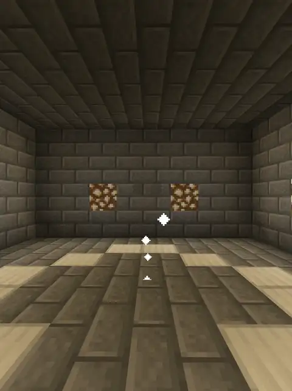

# Beaming

Beaming is travel with nothing to build. Save a place where you stand, then beam back to it from
anywhere with one command.

## What you see

1. You type the command. A glow gathers around you, and you vanish.
2. A column of light rises where you stood.
3. At the other end a column of light comes down and fades.
4. You are standing where the place was saved, facing the way it was facing.

The whole trip takes about two and a half seconds.

## Build one

There is nothing to build, only a place to save.

1. Stand where you want to come back to.
2. Type `/wormhole beam place set home`. Anyone can save their own places
   (`wormhole.beam.place`).
3. Go anywhere else, even another world.
4. Type `/wormhole beam to home`.
5. `/wormhole beam place list` shows your places, and `/wormhole beam place remove home`
   deletes one.

Staff can save a public destination for everyone with `/wormhole beam admin set <name>`, and
`/wormhole beam list` shows them. Both need `wormhole.beam.admin`, which operators have.

## Good to know

- **Your places come first.** A name is looked up in your own places, then in the public list.
- **Places are private.** Each player has their own, and a name can be reused by different
  players.
- **Beams cross worlds.** A destination in a world that is not loaded says so, rather than
  loading it.
- **The ground may have changed.** You are put on the nearest safe spot.
- **`/wormhole go <name>`** reaches the same places, and tries a gate name first. It needs
  `wormhole.go`, which is off by default.
- **The only way back is another beam.** Save a place where you left from.

## Who may do what

`wormhole.beam.use` lets players beam and list, and `wormhole.beam.place` lets them keep their own
places. Both are on for everyone. A server can add a per-player cooldown
(`beam-use-cooldown-enabled`) and a cost (`beam-economy-use-cost`), and a public destination can
have its own cost. Operators skip both.

## Go deeper

- [Beaming reference](../guide/BEAMS.md): every command, the animation and the settings.
- [Permissions](../guide/SERVER.md#permissions) for ranks.
