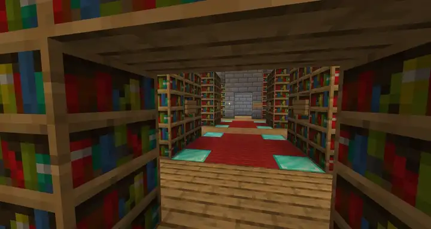
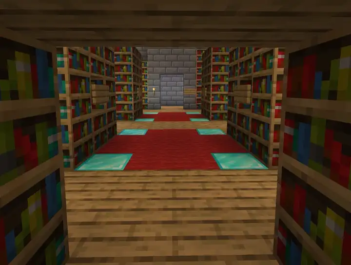

# Quantum mirrors

A quantum mirror is a banner on a wall. It shows the room it hangs in, then another world when
you right-click it, and a punch takes you through.

## What you see

Walk up to a mirror and the banner gives way to an opening its own size, showing a room in real
blocks. At first that is its own room, flipped as a mirror would show it.

Right-click and it shows the next mirror in the round, by name. Punch it and you go there,
landing in front of that mirror's banner and facing out into its room. Walk away and it goes back
to its own room.

## Build one

1. Hang a banner on a wall. A plain white one gets the `mirror` look, and a patterned one keeps
   its patterns.
2. Look at it and type `/wormhole mirror create library`. You need `wormhole.config`, which
   operators have.
3. Make another in a different world the same way, called `garden`. The two find each other.
4. Go up to `library` and right-click until it shows `garden`.
5. Punch it to go through, and punch the mirror there to come home.

If the wall has a gap, `create` names the block to fill. `/wormhole mirror remove` makes it an
ordinary banner again.

## Good to know

- **Nothing is built.** There is no frame, no pad and no partner.
- **Every mirror is on the network.** Nothing is pointed by hand.
- **One mirror to a world** by default (`mirror-per-world-limit`, `0` for no limit), so a
  right-click walks the worlds you can reach.
- **The wall stays.** Neither the banner nor the wall around it can be broken while it is a
  mirror.
- **It needs solid wall** a block out on every side of the opening. Two blocks out hides the
  room's edges better.
- **Two banners side by side** make one bigger mirror.
- **Pick the first stop** with `/wormhole mirror set archive -start hub`.

## Who may do what

Every `mirror` command needs `wormhole.config`, because a mirror moves players between worlds.
Operators have it.

Using a mirror, with right-click or punch, needs `wormhole.use.sign` or `wormhole.use.dialer`,
the same as dialling a gate. In simple mode, which is when no Vault permission provider is installed or
`permissions-support-disable` is on, everyone has them; otherwise grant one to whoever should travel
by mirror.

## Go deeper

- [Mirrors reference](../guide/MIRRORS.md): the commands, the look library and the settings.
- [Setting one up](../guide/MIRRORS.md#setting-one-up) for double-wide mirrors.
