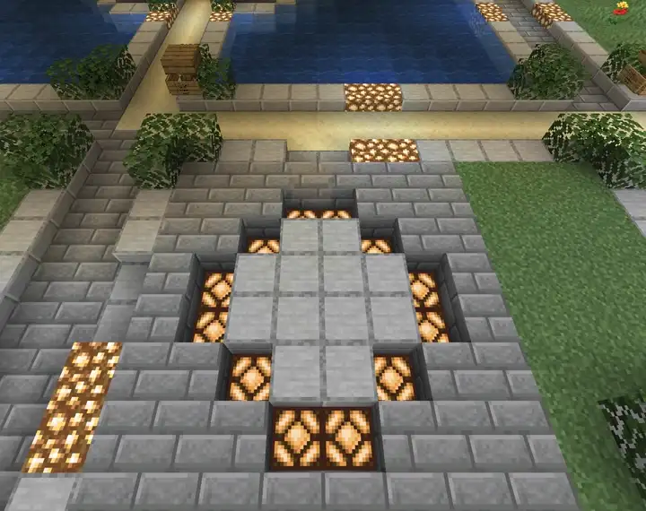

# Transport rings

A pair of rings is two circles of slabs in the same world. Walk into one and you swap places with
whatever is in the other, in a stack of rising rings and a flash of light.

## What you see

1. You step into the circle. The floor opens along the ring's pattern and counts down.
2. Four rings rise around you, one above the other.
3. A light runs through them, and you are at the other end.
4. The rings go home, and the pad stays lit for a moment.

Step clear before the countdown ends and nothing happens. A ring in a ceiling works the other
way round: its rings fall to the floor, so you stand inside them.

## Build one

1. Lay a circle of one kind of slab on the floor: seven across with 16 slabs, or six across with
   12. The [reference](../guide/RINGS.md#building-a-ring-pair) has the shape.
2. Stand inside it and type `/wormhole ring create`. You need `wormhole.ring.build`.
3. Go somewhere else in the same world and lay a second circle.
4. Stand inside it and type `/wormhole ring create` again. The two are now a pair, and the slabs
   are used up.
5. Walk into one. You arrive in the other.

A refusal says what is wrong, such as a slab out of place or too little headroom.
`/wormhole ring cancel` forgets a half-built pair; the circle you laid stays, so pair it later or
pick the slabs up yourself.

## Good to know

- **Everything inside travels.** Players, mobs, items and vehicles. Ride in on a horse and you
  arrive still on it.
- **Both ends swap.** Two people standing at opposite ends trade places.
- **The far end must be clear.** Every square needs room and solid ground. A refused trip costs
  nothing.
- **A pair rests for thirty seconds** after carrying someone.
- **Name an end** with `/wormhole ring edit name Tower`, standing in it. The other end then tells
  travellers where they are heading.
- **Rings stay in one world.** They reach 256 blocks across, and 384 in height, the Overworld's height.
- **Nothing is built.** The rings and lights are drawn for nearby players, so they do not light
  up a room.

## Who may do what

Anyone can travel by a ring they are allowed on (`wormhole.ring.use`). Building needs
`wormhole.ring.build`, and operators have it. A new pair is private: its owner can let other
players travel with `/wormhole ring allow <player>`, or open it with
`/wormhole ring edit access public`. A server can limit how many pairs one player owns
(`ring-max-pairs-per-player`, 10 by default). `wormhole.ring.admin` manages any pair.

## Go deeper

- [Rings reference](../guide/RINGS.md): settings, editing, and trying a ring before you build it.
- [Previewing a ring](../guide/RINGS.md#previewing-a-ring) to see the whole cycle on its own.
- [Permissions](../guide/SERVER.md#permissions) for ranks.
