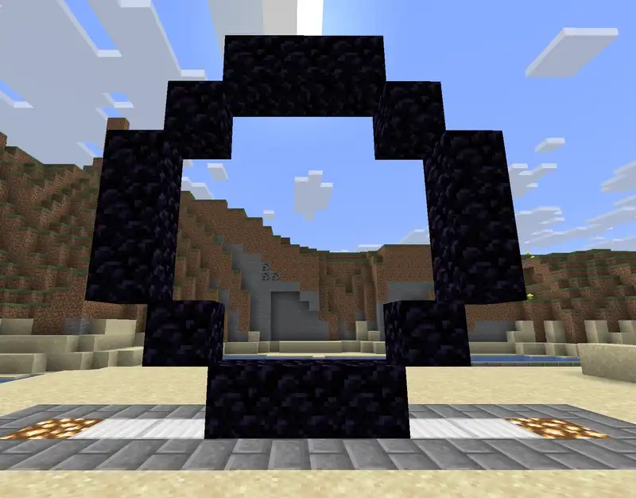
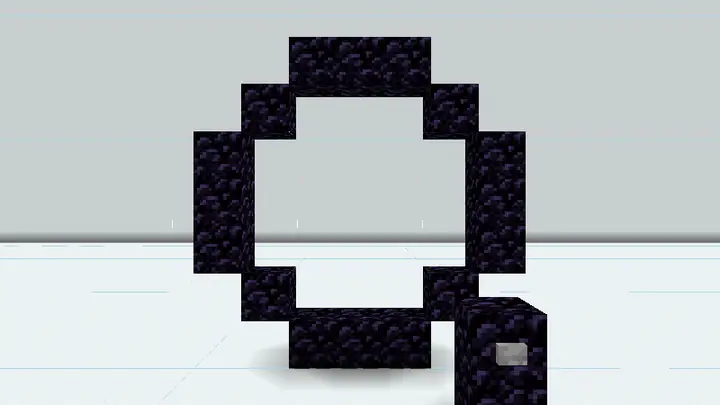

# Stargates

A stargate is a frame of blocks with a button beside it. Dial another gate and a wormhole opens;
step through and you come out at the other end, even in another world.

## What you see

1. You click the button. The chevrons light up one by one, and a light can run round the ring
   before each one locks.
2. The last chevron locks and the gate holds for a moment.
3. The wormhole bursts out of the opening, then settles into a shimmering surface.
4. You walk in. You arrive at the other gate, facing out of it.

A dial to a gate in another world locks an eighth chevron at the bottom of the ring.

## Build one

1. Stand where you want it and type `/wormhole gate build Standard`. Add a material group to
   change the look, such as lapis for an Atlantis gate. You need `wormhole.build`.
2. Lay the frame. With `wormhole.build.preview` a full-size ghost shows where each block goes,
   only to you, and `/wormhole gate preview guide` marks what is still missing.
3. Put a button on the DHD block and click it.
4. Name it: `/wormhole gate complete Home`. Add `net=<network>` to put it on a network, or
   `idc=<code>` to give it an iris code.
5. Build a second gate the same way, called `Away`.
6. Click the button at `Home`, type `/dial Away`, and step into the opening.

For a gate that dials by itself, hang a sign on the dial block: right-click steps through the
destinations, and clicking the button dials the one shown.

## Good to know

- **A wormhole runs one way.** The gate you dial is an exit. Mobs cannot wander in from there.
- **Almost everything goes through.** Minecarts, boats, horses with riders, arrows, ender pearls,
  and your tamed pets beside you.
- **An iris shuts a gate.** Give it a code and the plugin places an iris lever; a closed iris
  turns travellers back.
- **A gate needs room to open.** `/dial` is refused if the far gate is busy or has its iris
  closed.
- **Redstone can dial a gate** that has a sign.
- **Taking one down:** `/wormhole gate remove <gate>`, and `-destroy` takes the frame too.

## Who may do what

Operators can do everything. Everyone else needs `wormhole.build` to build and
`wormhole.use.dialer` to dial; `wormhole.use.sign` lets them use dial signs. A server can limit
how many gates a player owns and how close two gates may stand. `wormhole.remove.own` lets players
remove their own gates.

## Go deeper

- [Gates reference](../guide/GATES.md): shapes, materials, signs, the iris and redstone.
- [Gate shapes in 3D](../manual/gates.md), [iris styles](../manual/iris.md) and
  [dialling and chevrons](../manual/dialling.md): watch each one before you build.
- [Permissions](../guide/SERVER.md#permissions) for ranks.
