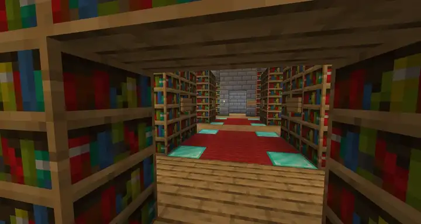
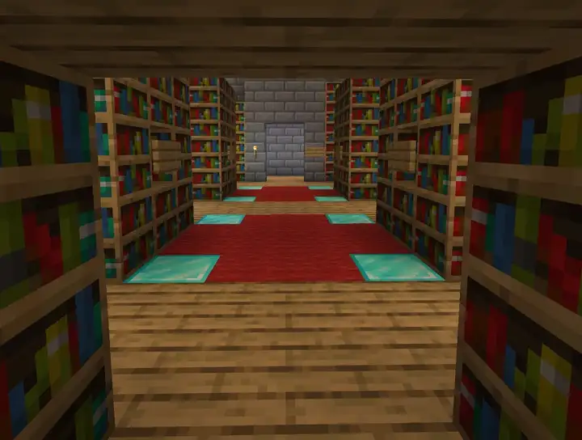
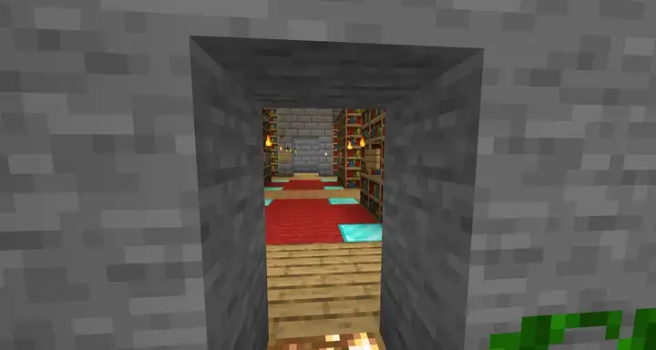

# Quantum mirrors

A **quantum mirror** is a banner on a wall. Walk up to it and it shows its own room, as a mirror
does; right-click it to choose another mirror, and punch it to go through. Nothing is built: no
frame, no pad, no partner. Why it works the way it does — the look library, what was tried and
dropped — is in the design notes, [docs/MIRRORS.md](../MIRRORS.md).

- **Every mirror is on the network.** Nothing is pointed by hand. A right-click walks the other
  mirrors, and a punch goes to the one showing.
- **One to a world** by default (`mirror-per-world-limit`, `0` for no limit), so the list a
  right-click walks is the worlds you can reach.
- **On a wall, and it stays there.** A mirror needs solid wall a block out on every side of its
  opening, and neither the banner nor that wall can be broken while it is a mirror.

## Contents

- [Setting one up](#setting-one-up)
- [Groups, hidden and private mirrors](#groups-hidden-and-private-mirrors)
- [A sign to choose with](#a-sign-to-choose-with)
- [Commands](#commands)
- [What you see in one](#what-you-see-in-one)
- [Its look](#its-look)
- [Saying what it is](#saying-what-it-is)
- [Nether portals](#nether-portals)
- [Settings](#settings)

## Setting one up

Hang a banner on a wall, look at it, and:

```
/wormhole mirror create library
```

That is the whole job. A plain white banner gets the `mirror` look; one you patterned first keeps
its patterns. Make a mirror in another world the same way, and the two find each other.

- **Right-click** a mirror to move it on to the next of the other mirrors, by name, round and
  round. Its own room is never in the round: that is what it shows before anybody clicks, and
  what it goes back to once nobody is near. Alone at a mirror, click through as fast as you like;
  with somebody else there, what it shows stays up three seconds.
- **Punch** it to go to the mirror it is showing. You land in front of that mirror's banner,
  facing out into its room.
- **Give it a start** to put one mirror first in its list: `/wormhole mirror set archive -start hub`
  makes the first right-click on `archive` open onto `hub`, and the next go on through the rest by
  name. `-start -none` takes the start away.



A whole round trip, in three seconds and without a command: a punch at a library mirror, a tower
over an ocean at the other end, and a punch at the mirror there to come home.

**The wall.** A mirror needs solid wall a block out on every side of its opening; `create` refuses
a gap and names the block to fill. Two blocks out hides the room's edges better from an angle,
so `create` also says which block is short of two. A banner on a post cannot be a mirror.
`mirror remove` takes one down; nothing else can.

**Two banners wide.** Hang two wall banners side by side, facing the same way, and `create` on
either: the pair is one mirror, two wide and two tall. Either banner answers a click, and a
traveller lands between them. The wall must then be solid four across and four tall — one block
either side of the banners, and from one above them to one below the opening. A mirror already
made one wide stays one wide: `remove` it, hang the second banner, and `create` again.

## Groups, hidden and private mirrors

Every mirror starts on the public network, and a right-click on one lists every other mirror on
it. Three settings narrow that list, and all three are off until you set them.

- **A group.** `mirror set lobby -group museum` puts `lobby` in a group called `museum`. A
  right-click on a mirror in a group lists only the other mirrors in that group, and a mirror with
  no group lists only the others with none, so a museum wing's mirrors list the museum and the
  survival hub's list the hub. Case does not matter. `-group -none` puts it back on the public
  network.
- **Hidden.** `mirror set return -hidden on` leaves `return` out of every right-click list,
  whoever is clicking. It is still reachable as another mirror's start: give the mirror that
  should lead to it `-start return`. `-hidden off` lists it again.
- **Private.** `mirror set staff -private on` lists `staff` only for players with
  `wormhole.mirror.private`, which operators have by default. Mirrors have no owner, so the
  permission is the only way in, apart from a start. `-private off` lists it for everybody again.

**A start is always reachable.** A mirror's start is first in its list whatever group the start
is in, and whether or not it is hidden or private: whoever set the start chose it.

**A punch asks again.** What a mirror shows is shared by everybody at it, so a player without the
permission could otherwise follow a staff member's choice into a private mirror. A punch goes
through only if the puncher's own right-click would reach that mirror; otherwise it says so, and
a right-click turns the mirror to one they may use. The line above the hotbar does not name a
mirror the player could not reach either; it asks them to choose another.

**A private room is not left showing.** The view in a mirror is the same for everybody at it, so
a right-click skips a private mirror while somebody without the permission is in range, and a
mirror already turned to one goes back to its own room at the next sweep after such a player comes
near: they may glimpse it for about a second. A start is the exception, as above.

**Web maps** leave hidden and private mirrors off; a mirror in a group is marked as before.

`mirror-per-world-limit` still counts every mirror in a world, whatever its group.

## A sign to choose with

For anybody who would rather see the list than click through it blind, put a sign touching a
mirror's banner (beside it, under it or above it) and write `[mirror]` on the first line of its
front. Right-click the sign and the mirror moves on, as a right-click on the banner does, and the
sign shows the mirror's name, then the previous, current and next mirror:

```
-library-
tower
»garden«
nether
```

Before anybody chooses, the middle line says `Its own room` and the last the mirror the first
click opens onto. The banner still answers a right-click; the sign sits beside it. A punch on the
sign does nothing to the mirror, so the sign can be broken like any other.

**One list for everybody.** A sign is read by everybody who walks past, so it walks the public
list only: the mirror's start (named even if hidden, as on the banner), then its group's listed
mirrors, never another hidden or private one, even for a player with `wormhole.mirror.private`. If somebody allowed a private mirror turns the banner to
one, the sign's middle line is left blank rather than naming it. The sign is redrawn whenever the
mirror moves on, and when it goes back to its own room. A right-click on it never opens the sign
for editing; to rewrite it, or after the mirror is created again under another name, break it and
put up a fresh `[mirror]` sign. Its colours and glow are the dial sign's
(`sign-color-gate-name`, `sign-color-selected`, `sign-color-neighbour`, `sign-glowing-text`).

## Commands

| Command | What it does |
| --- | --- |
| `mirror create <name>` | Makes the banner you are looking at a mirror, or renames the one already there |
| `mirror create <name> <world> <x> <y> <z>` | The same for the banner at those coordinates, for the console and command blocks; x y z may be `~`, counted from whoever runs it |
| `mirror set [name] -start <mirror\|-none>` | The mirror a right-click opens onto first; `-none` takes it away |
| `mirror set [name] -stamp [look]` | Makes the banner look like where it goes. See [Its look](#its-look) |
| `mirror set [name] -capture` | Takes the room's capture again |
| `mirror set [name] -follow <on\|off>` | Makes the banner follow where it opens first. See [Its look](#its-look) |
| `mirror set [name] -group <group\|-none>` | Lists only the mirrors in a named group; `-none` puts it back on the public network. See [Groups](#groups-hidden-and-private-mirrors) |
| `mirror set [name] -hidden <on\|off>` | Leaves it out of every right-click list; still reachable as a start |
| `mirror set [name] -private <on\|off>` | Lists it only for players with `wormhole.mirror.private` |
| `mirror remove [name]` | Makes it an ordinary banner again |
| `mirror list` | Every mirror, and what each is showing |
| `mirror debug [name] [-all\|-full\|-on\|-off]` | Why a mirror draws what it draws. See [below](#what-you-see-in-one) |
| `mirror debug <gate>` | Whether a gate's view is drawn, and if not, why |
| `mirror debug -views` | Every view you are being drawn, a gate's too, and how far each reaches |

All of them need `wormhole.config`: a mirror moves players between worlds.

**Using** a mirror, with right-click or punch, needs `wormhole.use.sign` or `wormhole.use.dialer`,
the same as dialling a gate. In simple mode, which is when no Vault permission provider is
installed or `permissions-support-disable` is on, everyone has them; otherwise grant one to
whoever should travel by mirror. Operators always may. A private mirror also needs
`wormhole.mirror.private`, unless it is the start of the mirror clicked.

**Leave the name out** to mean the banner you are looking at: `mirror set -start hub`,
`mirror set -stamp cavern`, `mirror remove`. What `set` changes always starts with a dash, and
no mirror's name may, which is how it tells the two apart. Where a word could still be either —
`set -stamp cavern` with a mirror *and* a look called `cavern` — the mirror wins.

**Rename** by running `create` again while looking at a banner that is already a mirror. It keeps
its start and its look; only the name changes. `create` with a name it already knows moves that
mirror to the banner you are looking at instead. The one thing it refuses to guess is a name that
belongs to a mirror elsewhere *and* a banner that is already a different mirror; it says so and
changes nothing.

## What you see in one



One mirror, two rooms: the library it hangs in, then the garden a right-click pointed it at. Nothing
was built for the second — the same banner, showing somewhere else.

Come within `mirror-proximity-distance` blocks on the banner's side and the banner gives way to
an opening its own size, showing a room in real blocks: its own, flipped as a mirror would show
it, or the room of the mirror chosen at it. Real blocks, so the view has depth and shifts as you
move past. Nothing in the world changes; only the players looking in are sent the view. From
behind, a mirror is its banner. (On plain 1.20 the banner stays in front of the view.)



The clip is how you can tell it is not a picture painted on the banner: a texture would not shift
as the camera moves past.

**What it shows is a capture** — a photograph of the room, taken from where a traveller lands,
reaching as far as that world sends and kept in `data/captures/mirrors/`. A new mirror's is taken
within a second of `create`; another mirror's room is captured the first time somebody chooses
it. After that its world need not be loaded, so a mirror in an archived world still shows.
Nothing retakes a capture on its own: when the room has changed, run `mirror set -capture`.

**How far it reaches** is `view-depth`, 160 blocks by default — ten chunks, about as far as a
server sends — and nothing is drawn past it. The same setting sets how far an open gate's view
reaches. Lower it for views onto somewhere small; a shallower view is also a smoother one, since
the client has less to redraw as you come and go.

**A mirror in a solid wall shows the whole room** — solid for the proximity distance on every
side of the opening, with no other mirror within twice the depth, which `create` warns about.
Any other mirror shows only what you could actually see through the opening, and the far part of
that view follows you a step late, redrawn when you cross into another block rather than on every
step. A redraw that took long rests before the next, so a deep mirror cannot take more than a
quarter of the server's time however close you stand.

**Past the room, this world shows.** The client goes on drawing the hills behind the wall past
the far edge of the view. The setting that pulled your fog in to the room's depth was removed in
1.11.0.

**Blocks, and creatures if the server turns them on.** With `mirror-show-entities` on, the mobs
standing in the room show through the mirror (or an open gate) as copies only you see, and so do its
boats and minecarts, every cart as a plain empty one and a chest boat as a plain boat; it is off by
default. With `mirror-show-players` on as well, so do the players there, by name: a mannequin in
their skin from Minecraft 1.21.9, an armour stand wearing their head before. A mirror showing its
own room shows the others in front of it, flipped, as a mirror does. Never yourself through a mirror
(through a gate whose far room is close by and covers you, such as one facing it, you do), nor
anyone invisible, spectating or riding something, nor anyone a vanish plugin hides from you with
`hidePlayer`; a plugin that hides players by rewriting packets is not seen by this check, and its
players do show. The skin is the player's real one, not a disguise plugin's, so a server that
hides who its players are should leave it off; the account's name and id are not sent with it. While you look, a small area in front of the
far side is kept loaded so its creatures show on the first look (`mirror-entity-load-radius`). Your own world's creatures inside the view are hidden while
you look. The room is lit by this world, so a room behind a wall is
dark except for what makes its own light. Lava hides what is behind it and water is seen through
for about thirty blocks, as in the game.

**Checking a mirror.** `/wormhole mirror debug <name>` says what its capture is and how your view
of it is drawn; `-all` lists every fact, green where it is drawn whole and red for whatever trims
or stops it — a gap in the wall, another mirror too near, a missing capture file. `-full` draws
the whole capture for you alone, wherever you stand; any other mirror you look into meanwhile
keeps its banner. A room being built shows the mirror's banner until it is ready. `mirror debug -off` turns views off for you,
so you see the world as it is, and `-on` puts them back. `mirror debug -views` needs no mirror:
it lists every view you are being drawn, including a gate's (`gate-view`), with how far that gate's
capture reaches, whether it was cut to fit, how deep it is drawn and how old it is.
`mirror debug <gate>` names a gate instead of a mirror and says what `gate-view` is, and whether the gate's
view is drawn and, if not, why: not open, iris shut, the end that was dialled, an opening that cannot show one,
nobody near enough, its world not loaded, no arrival point at the far gate, a horizon that hides the
view, or its capture still being taken. `-all` and `-full` are for a mirror. `debug` is not
in the usage line, but
tab-completes for anyone who may run it.

## Its look

The look is what the banner shows from further than `mirror-proximity-distance`, from behind, and
before a room is captured — so a corridor of mirrors still reads as a row of doors from the far
end. A plain white banner made a mirror gets the `mirror` look: pale glass, a glint and a frame.
A banner you patterned first keeps its patterns.

```
/wormhole mirror set museum -stamp cavern   # a named look
/wormhole mirror set museum -stamp          # read the mirror's room and paint the banner from that
```

Read from the room, the biome picks the frame — rising flame for the Nether, white crests over
blue for an ocean — and the blocks around it become coarse squares in their dominant colours.
Indoors, the room's own blocks decide instead, so a library comes back the brown of its shelves.

Ninety looks ship: one for every biome in the game, and the rest say something about the mirror
instead — `mirror`, `hub`, `exit`, `market`, `warning`, `private`, `plain` and more. None change
what a mirror does: the `private` look is paint, and `-private` is the
[setting](#groups-hidden-and-private-mirrors) that keeps a mirror out of a list. They are `.mirror` text files in
`shapes/mirror/`; edit one and it stays edited, delete one and it comes back, add your own and
`-stamp` offers it. Every look is drawn, with its recipe, in
[the library](../MIRRORS.md#the-library-at-a-glance).

A look never changes on its own: stamp it again when the room has changed. `-stamp` is about the
banner and leaves the capture alone; `-capture` is the reverse.

**Or let it follow.** `mirror set museum -follow on` stamps the banner from the room it opens onto
first, its start's or its own without one, read from that room's capture the way `-stamp` reads a
room. It is stamped again when you change the start and when that room is captured again, never
on a right-click, so the banner says where the mirror goes rather than wherever somebody last
clicked it. Until the room has a capture the banner is left as it is, and a banner far off in an
unloaded chunk takes its look when that chunk next loads, if that is before a restart. It is off by default, since
a look you chose by hand should stay; `-follow off` keeps whatever the banner shows then, and a
`-stamp` on a following mirror lasts until its next re-stamp. `mirror list` marks the mirrors that
follow.

A capture keeps the blocks but not the biome, so a following banner reads the biome only where the
room's chunk happens to be loaded. Otherwise the Nether gets the Nether's frame, the End the End's,
and anywhere else the generic one, with the room's own colours in it as usual.

## Saying what it is

Look at a mirror from about six blocks and it says what a click will do, above the hotbar:

```
:: museum -- right-click to choose a mirror.
:: museum -- punch to travel to hub, right-click for another.
```

It stays while you keep looking, and only the mirror under your crosshair speaks.
`mirror-approach-message: false` turns it off.

## Nether portals

With `nether-portal-views: true`, a vanilla nether portal shows the other side behind its purple
sheet, the way an open gate does with `gate-view: behind`. It is a picture drawn for each viewer;
nothing in the world changes, and vanilla still decides where a portal goes and takes you there.

- **Only after a trip.** A portal shows nothing until somebody has gone through it. It then shows
  the portal they came out of, turned the way vanilla turned them. The way back is learnt by
  going back. Links are kept until the plugin stops, and forgotten when either portal is broken.
- **Captured from what is loaded.** The far side is captured as the traveller arrives, or while
  somebody stands at the far portal. No chunk is loaded to draw the blocks, so a portal whose far
  side nobody has been near since a restart shows nothing.
- **Creatures too.** With `mirror-show-entities: true` the mobs in the far room show, and the players
  with `mirror-show-players: true`, as through a gate; the chunks in front of the far portal are
  then held while somebody looks, as for a gate (`mirror-entity-load-radius`).
- **One at a time.** You are drawn only the portal you look at, from the side you stand on, within
  `mirror-proximity-distance`. Step into the portal and the drawing ends, so you walk in as usual.
- **Up to 18 blocks wide or tall.** Bigger portals stay plain.
- Being drawn one needs `wormhole.view.netherportal`, which everyone holds.

It is an experiment ([#514](https://github.com/khanjal/Wormhole-X-Treme/issues/514)). How it is
built is in the [design notes](../MIRRORS.md#nether-portals).

## Settings

In `config.yml` under `# --- Gate views and mirrors ---`, which opens with `view-depth` and also
holds the gate views (`gate-view`, `gate-view-funnel`, `gate-view-funnel-length` and `gate-view-funnel-min-length`, under
`# -- Gate views --`; the funnel three are in [GATES.md](GATES.md#a-big-gate-onto-a-small-one)).
The mirror settings follow in three runs, each under its own `# -- ... --` sub-heading.

| Setting | Default | What it does |
|---|---|---|
| `view-depth` | 160 | How far from the opening a mirror's room, or an open gate's far side, is drawn, 4 to 160. A gate shows the first 32 at once and fills in the rest behind. |

An upgraded `config.yml` without `view-depth` gets the shallower of its old `mirror-view-depth`
and `gate-view-full-depth`, written to the file as `view-depth`.

### Nether portal views

| Setting | Default | What it does |
|---|---|---|
| `nether-portal-views` | `false` | Whether nether portals show the far side once somebody has travelled through them. |
| `nether-portal-view-worlds` | (empty) | The worlds whose portals may show one, comma-separated, such as `world, world_nether`. Both ends of a trip must be listed. Empty for every world. |

### Mirror views

| Setting | Default | What it does |
|---|---|---|
| `mirror-proximity-distance` | 16 | How close a player must be for the banner to give way to the room, and how near they must stay. It is checked once a second; mirrors whose world or chunk is not loaded are skipped. |

### Creatures and players in a view

| Setting | Default | What it does |
|---|---|---|
| `mirror-show-entities` | `false` | Show the mobs, boats and minecarts in a mirror's or an open gate's far room, as copies only the viewer sees. |
| `mirror-show-players` | `false` | With `mirror-show-entities` on too, show the players there as well. It tells a viewer who is at the destination. |
| `mirror-entity-load-radius` | 2 | With creatures shown, how many chunks in front of a watched far side are held, as `/forceload` holds them: 15 at 2, each with a two-chunk ring kept loaded round it, about 63 chunks loaded in all. 0 for none, at most 4. The ring can generate terrain at the edge of explored land. |

### Quantum mirrors

| Setting | Default | What it does |
|---|---|---|
| `mirror-per-world-limit` | 1 | How many mirrors one world may hold. `0` for no limit. |
| `mirror-approach-message` | `true` | Whether a mirror names itself above the hotbar to whoever looks at it. |
