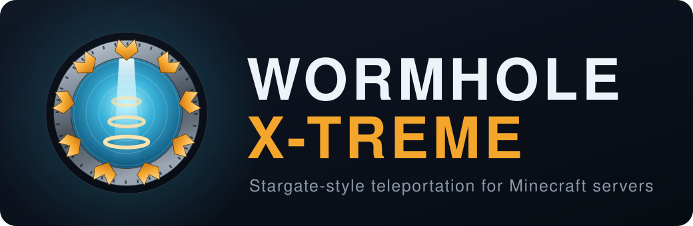

# Wormhole X-Treme

Stargate-style travel for Bukkit, Spigot and Paper servers, on Minecraft 1.20 through 26.3. Build
a gate, dial another one, and step through; or build a ring or a beam pad for shorter hops.

- **[Guide](guide/README.md)** is for players and server owners: installing, configuring,
  building gates, rings, beams and mirrors, and translating the messages.
- **Internals** is for contributors and plugin authors: how [gates](GATES.md), [rings](RINGS.md),
  [beams](BEAMS.md) and [mirrors](MIRRORS.md) are designed, the [API](API.md), and the
  [development guide](DEVELOPMENT.md).
- The [changelog](https://github.com/khanjal/Wormhole-X-Treme/blob/main/CHANGELOG.md) lists every
  release; downloads and the source are on
  [GitHub](https://github.com/khanjal/Wormhole-X-Treme).
