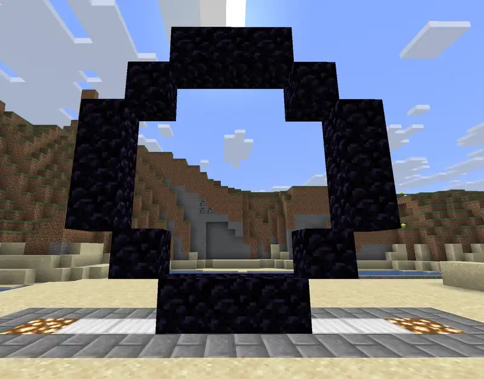
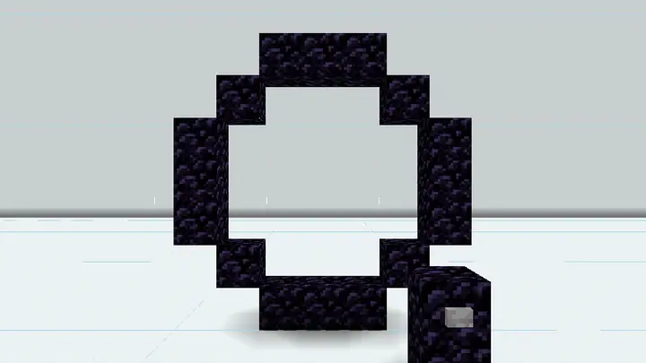
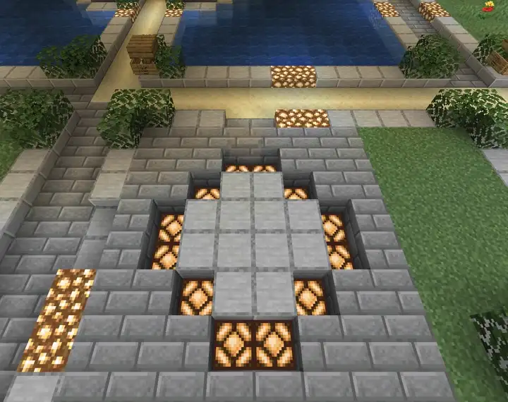
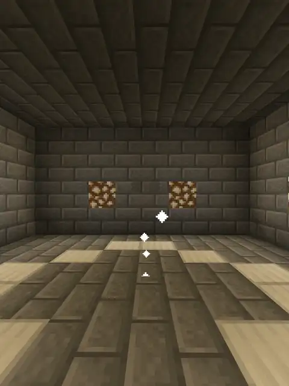
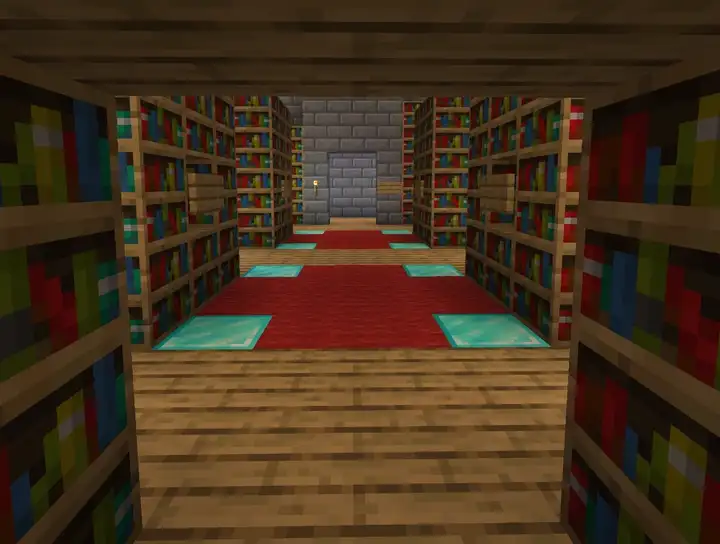

# Wormhole X-Treme

{ width="420" }

**Build a gate. Dial a friend's base. Step through.**
Stargate-style travel for your Minecraft server, with transport rings, beaming and quantum mirrors
for shorter hops.

[Get started](start.md){ .md-button .md-button--primary style="margin:0.25rem" }
[Download on Modrinth](https://modrinth.com/plugin/wormhole-x-treme){ .md-button style="margin:0.25rem" }
[Hangar](https://hangar.papermc.io/khanjal/Wormhole-X-Treme){ .md-button style="margin:0.25rem" }
[SpigotMC](https://www.spigotmc.org/resources/wormhole-x-treme.138936/){ .md-button style="margin:0.25rem" }
[See the gates in 3D](manual/gates.md){ .md-button style="margin:0.25rem" }

## Four ways to get somewhere

-   **Stargates**

    ---

    

    Lay a frame of blocks and press the button. The chevrons light up one by one, then the
    wormhole opens. Step in and you come out at any other gate, even in another world.

    [Stargates in detail](features/stargates.md)

-   **Transport rings**

    ---

    

    Lay a circle of slabs, then another one somewhere else. Walk into one and a stack of rings
    rises around you, light runs through it, and you arrive at its partner.

    [Rings in detail](features/rings.md)

-   **Beaming**

    ---

    

    Nothing to build. Save a place where you stand, then beam to it from anywhere. You leave in
    a column of light.

    [Beaming in detail](features/beaming.md)

-   **Quantum mirrors**

    ---

    

    Hang a banner on a wall and it shows the room it is in. Right-click to choose where it opens
    onto, punch it, and you step through.

    [Mirrors in detail](features/mirrors.md)

## Run it on your server in three steps

1. **Drop the jar into `plugins/`** and restart the server. Nothing else is needed.
2. **Build a gate.** Type `/wormhole gate build Standard`, lay the frame, place a button on the
   DHD and click it, and name the gate with `/wormhole gate complete Home`.
3. **Build a second gate, called `Away`, and dial.** Click `Home`'s button, type `/dial Away`,
   and walk into the opening.

The full walk-through is in [Getting started](start.md).

## What you get

- Minecarts, boats, horses with their riders, and anything else that wanders in all travel through
  a gate.
- Six gate shapes, from a small ring to a huge one. A gate takes its look from the blocks you
  build it with: the same `Standard` shape in obsidian or in lapis gives two different-looking
  gates.
- Mirrors that show a room, in real blocks.
- Most settings change in game with `/wormhole config`, with no reload.
- Every sound is a setting, resource pack sounds included.
- It works with or without a permissions plugin, and charges through Vault only if you want it to.
- Gates are plain YAML files, and `/wormhole gate import` brings in gates from older forks.

## Compatibility

Minecraft 1.20 to 26.3, on Spigot, Paper and CraftBukkit (Purpur is best effort; Folia is not
supported). The jar needs Java 17 or later, and your Minecraft version may ask for more. The
[server setup guide](guide/SERVER.md#compatibility) has the details.

---

-   **[For server owners](guide/SERVER.md)**

    Install, set permissions and [configure](guide/SERVER.md#configuration), with a
    [reference](guide/README.md) for each feature.

-   **Features**

    [Stargates](features/stargates.md) · [Rings](features/rings.md) ·
    [Beaming](features/beaming.md) · [Mirrors](features/mirrors.md)

-   **For developers**

    [Gate internals](GATES.md) · [API](API.md) · [Development](DEVELOPMENT.md)

