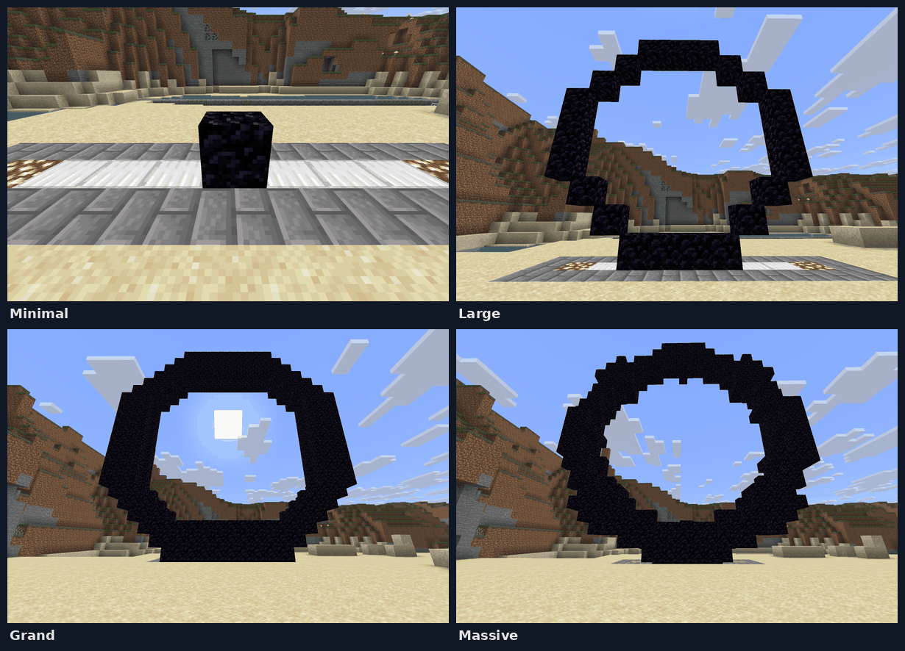
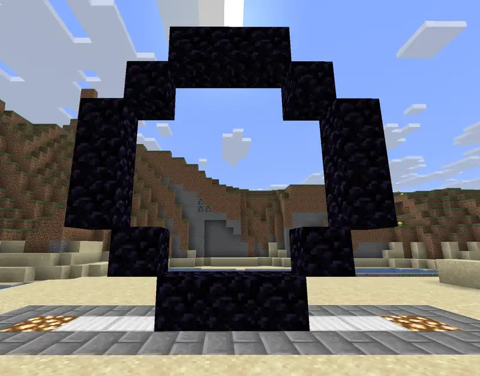

# Getting started

Your first gate, from an empty `plugins/` folder to walking through a wormhole. It takes about ten
minutes.

## What you need

- A Spigot, Paper or CraftBukkit server on Minecraft 1.20 to 26.3 (Purpur is best effort).
- Java 17 or later. Minecraft 1.20.5 and later need Java 21 on the server, and 26.1 and later
  need Java 25.
- Operator status, to follow along as written. Anyone else needs `wormhole.build` to build and
  `wormhole.use.dialer` to dial; see [permissions](guide/SERVER.md#permissions).
- Obsidian for the frame of a `Standard` gate.

## Install

1. Download `WormholeXTreme-<version>.jar` from
   [Modrinth](https://modrinth.com/plugin/wormhole-x-treme),
   [Hangar](https://hangar.papermc.io/khanjal/Wormhole-X-Treme),
   [SpigotMC](https://www.spigotmc.org/resources/wormhole-x-treme.138936/) or the
   [GitHub releases](https://github.com/khanjal/Wormhole-X-Treme/releases/latest).
2. Put it in your server's `plugins/` folder.
3. Restart the server.

The first start writes `plugins/WormholeXTreme/` with a `config.yml` and the gate shapes. Nothing
needs editing to carry on.

## Build your first gate

1. Stand where you want the gate and type:

    ```
    /wormhole gate build Standard
    ```

    With `wormhole.build.preview`, which operators have, a full-size ghost of the gate stands in
    front of you. Only you can see it, and you can walk through it. Build where it stands.
    `/wormhole gate preview needs` lists the blocks you need.

    

2. Lay the frame in obsidian. `/wormhole gate preview guide` draws what is still missing.
3. Put a button on the DHD block, the one the ghost has its button on, then click it.
4. Name the gate:

    ```
    /wormhole gate complete Home
    ```

    The gate places its name sign and levers, and it is saved.

## Build a second gate

Go somewhere else, in the same world or another, and do it all again. Name this one `Away`:

```
/wormhole gate build Standard
/wormhole gate complete Away
```

## Dial and step through

1. Stand at `Home` and click its button. Every chevron lights and the gate waits for you.
2. Type:

    ```
    /dial Away
    ```

    The chevrons lock one by one, then the wormhole bursts open.

    

3. Walk into the opening. You come out at `Away`.

A wormhole runs one way: `Away` is only an exit. To come back, click the button at `Away` and type
`/dial Home`. `/wormhole gate list` shows every gate you can see.

## Where next

- [Gates](guide/GATES.md): shapes, materials, signs, the iris and redstone.
- [Look at every gate shape in 3D](manual/gates.md) before you build a big one.
- [Rings](guide/RINGS.md), [beaming](guide/BEAMS.md) and [mirrors](guide/MIRRORS.md).
- [Server owner's guide](guide/SERVER.md): configuration, permissions and commands.
